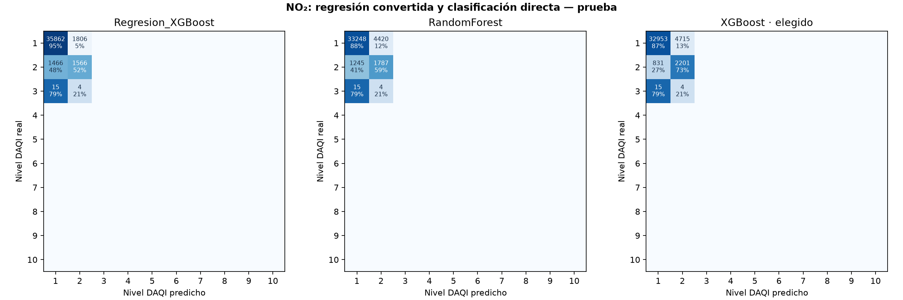
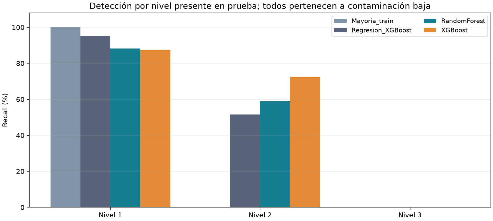

# Piloto: clasificación directa de NO₂

El clasificador elegido por validación fue XGBoost. En prueba, su F1 macro sobre clases presentes es 0.4548, frente a 0.4816 del método de regresión convertido (diferencia -0.0268). Accuracy 86.33% y balanced accuracy 53.36%.

## Método y límites

- Un clasificador de NO2 compartido entre estaciones; la estación es una entrada. La salida es el nivel británico, no una concentración ni una categoría diaria conjunta.

- Se reutilizan las mismas 59 entradas, objetivos medidos/censurados y filtros de plausibilidad. NO2 y los otros contaminantes no son predictores. Las concentraciones originales se conservan.

- Entrenamiento anterior a 2024; validación en 2024; prueba desde 2025, con la misma purga de dos días. Pesos y codificación de clases se calculan sólo con entrenamiento. Los modelos y el exponente de ponderación se eligen únicamente por F1 macro de validación; no se retocan después de ver el test.

- Se prueban pesos sin balancear, raíz de frecuencia inversa y frecuencia inversa completa. Todos se normalizan a media uno. No se crean ejemplos sintéticos ni se balancean validación y prueba.

- Las clases ausentes de entrenamiento no pueden aprenderse: conservan probabilidad cero y se indican en el manifiesto. Se codifican las presentes y se decodifican para no desplazar los niveles DAQI.

- Validación y prueba sólo contienen niveles 1, 2 y 3, todos de contaminación baja. No puede concluirse que el piloto detecte episodios moderados, altos o muy altos. El nivel 3 sólo tiene 19 ejemplos en test: sus métricas son inestables.

- F1/precision/recall macro promedian los diez niveles fijos y usan cero para clases no evaluables. Las variantes macro_supported consideran sólo niveles reales presentes. Se muestran ambas. FPR se calcula por clase contra el resto; cero FPR no garantiza detección.

- Se mantiene la conversión NO2 ppb × 1.9125 a µg/m³ y el redondeo único DAQI. Las cuatro bandas se evalúan aparte; en test todos los objetivos pertenecen a la banda baja.

- Los algoritmos siguen usando meteorología ERA5 histórica. No se evalúa aún el error adicional de pronósticos meteorológicos a 24/48 h. Las probabilidades del clasificador no están calibradas.

- El período de prueba ya se había inspeccionado al proponer este piloto: esta comparación es exploratoria. Una confirmación independiente requiere datos posteriores o un nuevo diseño de evaluación temporal.

## Comparación en prueba: diez niveles fijos

| model | n | accuracy | precision_macro | recall_macro | f1_macro | f1_macro_supported | balanced_accuracy | false_positive_rate_macro |
| --- | --- | --- | --- | --- | --- | --- | --- | --- |
| Regresion_XGBoost | 40719 | 0.9192 | 0.1424 | 0.1469 | 0.1445 | 0.4816 | 0.4895 | 0.0533 |
| Mayoria_train | 40719 | 0.9251 | 0.0925 | 0.1000 | 0.0961 | 0.3204 | 0.3333 | 0.1000 |
| RandomForest | 40719 | 0.8604 | 0.1251 | 0.1472 | 0.1308 | 0.4360 | 0.4907 | 0.0530 |
| XGBoost | 40719 | 0.8633 | 0.1293 | 0.1601 | 0.1365 | 0.4548 | 0.5336 | 0.0403 |

## Detalle por nivel del clasificador elegido

| category | support | predicted_count | precision | recall | f1 | false_positive_rate | tp | fp | fn | tn |
| --- | --- | --- | --- | --- | --- | --- | --- | --- | --- | --- |
| 1 · Baja | 37668 | 33799 | 0.9750 | 0.8748 | 0.9222 | 0.2773 | 32953 | 846 | 4715 | 2205 |
| 2 · Baja | 3032 | 6920 | 0.3181 | 0.7259 | 0.4423 | 0.1252 | 2201 | 4719 | 831 | 32968 |
| 3 · Baja | 19 | 0 | no evaluable | 0.0000 | 0.0000 | 0.0000 | 0 | 0 | 19 | 40700 |
| 4 · Moderada | 0 | 0 | no evaluable | no evaluable | no evaluable | 0.0000 | 0 | 0 | 0 | 40719 |
| 5 · Moderada | 0 | 0 | no evaluable | no evaluable | no evaluable | 0.0000 | 0 | 0 | 0 | 40719 |
| 6 · Moderada | 0 | 0 | no evaluable | no evaluable | no evaluable | 0.0000 | 0 | 0 | 0 | 40719 |
| 7 · Alta | 0 | 0 | no evaluable | no evaluable | no evaluable | 0.0000 | 0 | 0 | 0 | 40719 |
| 8 · Alta | 0 | 0 | no evaluable | no evaluable | no evaluable | 0.0000 | 0 | 0 | 0 | 40719 |
| 9 · Alta | 0 | 0 | no evaluable | no evaluable | no evaluable | 0.0000 | 0 | 0 | 0 | 40719 |
| 10 · Muy alta | 0 | 0 | no evaluable | no evaluable | no evaluable | 0.0000 | 0 | 0 | 0 | 40719 |

## Resultados por estación del clasificador elegido

| station | n | accuracy | precision_macro | recall_macro | f1_macro | f1_macro_supported | balanced_accuracy | false_positive_rate_macro |
| --- | --- | --- | --- | --- | --- | --- | --- | --- |
| centenario | 13874 | 0.9897 | 0.1010 | 0.1008 | 0.1009 | 0.5043 | 0.5038 | 0.0992 |
| cordoba | 13325 | 0.8875 | 0.1138 | 0.1348 | 0.1178 | 0.3926 | 0.4494 | 0.0662 |
| la_boca | 13520 | 0.7098 | 0.1306 | 0.1501 | 0.1297 | 0.4322 | 0.5002 | 0.0500 |

## Resultados de validación usados para comparar enfoques

| model | n | accuracy | precision_macro | recall_macro | f1_macro | f1_macro_supported | balanced_accuracy | false_positive_rate_macro |
| --- | --- | --- | --- | --- | --- | --- | --- | --- |
| Regresion_XGBoost | 16976 | 0.8864 | 0.1716 | 0.1440 | 0.1525 | 0.5082 | 0.4799 | 0.0559 |
| Mayoria_train | 16976 | 0.8212 | 0.0821 | 0.1000 | 0.0902 | 0.3006 | 0.3333 | 0.1000 |
| RandomForest | 16976 | 0.8709 | 0.1556 | 0.1589 | 0.1572 | 0.5239 | 0.5298 | 0.0410 |
| XGBoost | 16976 | 0.8759 | 0.1569 | 0.1668 | 0.1610 | 0.5368 | 0.5559 | 0.0332 |

## Fuentes

- [uk_thresholds](https://www.gov.uk/government/publications/health-effects-of-air-pollution/pollutant-concentrations-for-the-daily-air-quality-index-daqi)

- [uk_rounding](https://uk-air.defra.gov.uk/reports/cat14/1304251155_Update_on_Implementation_of_the_DAQI_April_2013_Final.pdf)

- [gas_conversion](https://uk-air.defra.gov.uk/reports/cat06/0502160851_Conversion_Factors_Between_ppb_and.pdf)
