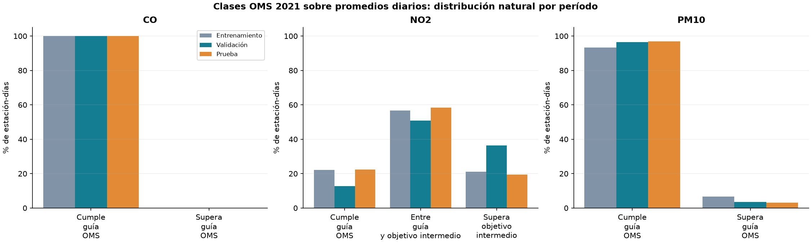
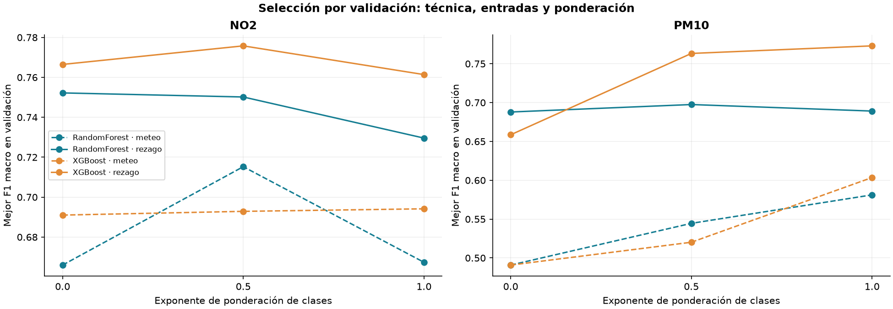
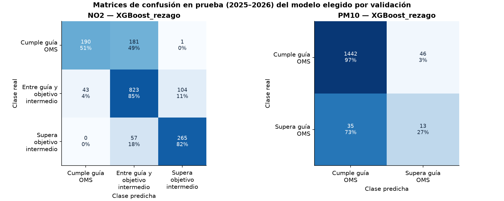
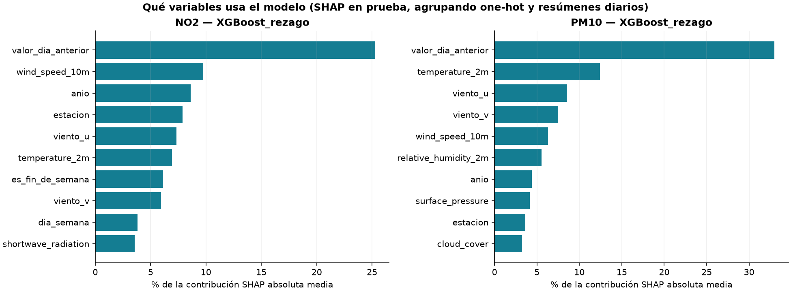
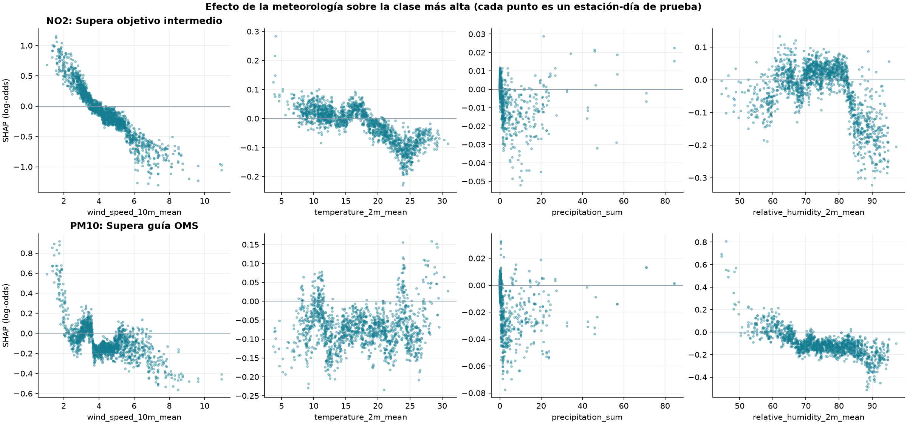
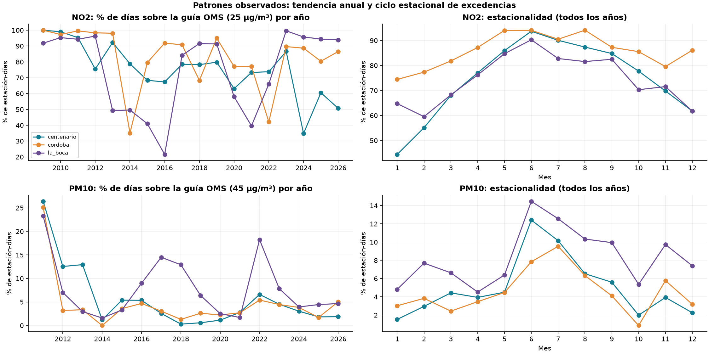

# Clasificación diaria con las guías OMS 2021

Estación-día, NO₂ y PM10. CO se describe.

- NO2: validación eligió XGBoost_rezago. En prueba, F1 macro 0.735 frente a 0.246 de la clase mayoritaria; balanced accuracy 72.7% y accuracy 76.8%. Variables más usadas (SHAP): valor_dia_anterior (25%), wind_speed_10m (10%), anio (9%), estacion (8%).

- PM10: validación eligió XGBoost_rezago. En prueba, F1 macro 0.608 frente a 0.492 de la clase mayoritaria; balanced accuracy 62.0% y accuracy 94.7%. Variables más usadas (SHAP): valor_dia_anterior (33%), temperature_2m (12%), viento_u (9%), viento_v (7%).

- CO: 0 estación-días superan la guía OMS de 4 mg/m³ en todo el período; con una sola clase no hay problema de clasificación y CO se analiza sólo con la regresión de la entrega.

## Método y alcance

- Motivación: con los cortes EPA casi todas las jornadas son Buena (0 Desfavorable en prueba) y la accuracy es alta sin detectar episodios. Las guías OMS 2021 son el estándar sanitario internacional vigente y más exigente; producen clases evaluables en NO2 y PM10.

- Las guías OMS se definen sobre promedios de 24 h. Se usa el promedio de los registros publicados del día de medición (al menos 18 horas válidas y 24 filas meteorológicas, igual que la clasificación diaria original). NO2 se publica horario; PM10 ya es un móvil de 24 h, por lo que su promedio diario es una aproximación. No es un dictamen de cumplimiento normativo.

- Cortes: NO2 guía 25 µg/m³ y objetivo intermedio 2 de 50 µg/m³ (el objetivo intermedio 1, 120 µg/m³, tiene muy pocos días y se agrupa); PM10 guía 45 µg/m³. Se reutilizan los factores de conversión del experimento de índices alternativos.

- Se mantienen los cortes temporales (entrenamiento antes de 2024, validación 2024, prueba desde 2025, purga de 2 días), las entradas diarias del modelado original y la exclusión de objetivos interpolados.

- Se compara un conjunto adicional de entradas con el promedio del día anterior del mismo contaminante (pendiente de la segunda entrega). Es información disponible al estimar el día siguiente.

- Grilla explícita por validación: Random Forest (max_depth 8/12/sin límite × min_samples_leaf 5/20) y XGBoost (max_depth 3/4/6 × 300/600 árboles), cada uno con pesos de clase 0, 0.5 y 1. Se elige por F1 macro de validación; la selección se guarda antes de calcular prueba.

- Las métricas de prueba se informan para el elegido y para los finalistas de cada familia y conjunto de entradas, sin cambiar la elección. Accuracy se lee junto a F1 macro, recall por clase y la matriz.

- La interpretación usa TreeSHAP nativo de XGBoost sobre la prueba: describe cómo usa el modelo cada variable, no relaciones causales. ERA5 es meteorología histórica; un pronóstico operativo agregaría el error de la previsión meteorológica.

## Distribución de clases OMS (estación-días)

| pollutant | category | purga | test | train | validation |
| --- | --- | --- | --- | --- | --- |
| CO | Cumple guía OMS | 10.0000 | 1679.0000 | 11109.0000 | 801.0000 |
| CO | Supera guía OMS | 0.0000 | 0.0000 | 0.0000 | 0.0000 |
| NO2 | Cumple guía OMS | 7.0000 | 372.0000 | 2457.0000 | 87.0000 |
| NO2 | Entre guía y objetivo intermedio | 3.0000 | 970.0000 | 6277.0000 | 346.0000 |
| NO2 | Supera objetivo intermedio | 0.0000 | 322.0000 | 2329.0000 | 248.0000 |
| PM10 | Cumple guía OMS | 8.0000 | 1488.0000 | 10147.0000 | 854.0000 |
| PM10 | Supera guía OMS | 0.0000 | 48.0000 | 734.0000 | 32.0000 |

## Finalistas por validación

| pollutant | model | feature_set | weight_power | max_depth | min_samples_leaf | n_estimators | validation_accuracy | validation_f1_macro | validation_balanced_accuracy |
| --- | --- | --- | --- | --- | --- | --- | --- | --- | --- |
| NO2 | RandomForest | meteo | 0.5000 | 8 | 5 | 300 | 0.7533 | 0.7152 | 0.6862 |
| NO2 | XGBoost | meteo | 1.0000 | 6 | — | 600 | 0.7533 | 0.6941 | 0.6763 |
| NO2 | RandomForest | rezago | 0.0000 | sin límite | 20 | 300 | 0.7695 | 0.7522 | 0.7428 |
| NO2 | XGBoost | rezago | 0.5000 | 6 | — | 600 | 0.7988 | 0.7758 | 0.7702 |
| PM10 | RandomForest | meteo | 1.0000 | sin límite | 20 | 300 | 0.9074 | 0.5812 | 0.6362 |
| PM10 | XGBoost | meteo | 1.0000 | 4 | — | 300 | 0.9187 | 0.6035 | 0.6571 |
| PM10 | RandomForest | rezago | 0.5000 | 12 | 20 | 300 | 0.9560 | 0.6975 | 0.7065 |
| PM10 | XGBoost | rezago | 1.0000 | 6 | — | 300 | 0.9684 | 0.7731 | 0.7731 |

## Prueba: elegido, finalistas y referencia

| pollutant | model | n | accuracy | precision_macro | recall_macro | f1_macro | balanced_accuracy | false_positive_rate_macro | f1_weighted |
| --- | --- | --- | --- | --- | --- | --- | --- | --- | --- |
| NO2 | Mayoria_train | 1664 | 0.5829 | 0.1943 | 0.3333 | 0.2455 | 0.3333 | 0.3333 | 0.4293 |
| NO2 | RandomForest_meteo | 1664 | 0.6659 | 0.7116 | 0.6295 | 0.6072 | 0.6295 | 0.2066 | 0.6499 |
| NO2 | XGBoost_meteo | 1664 | 0.6382 | 0.7017 | 0.6059 | 0.5736 | 0.6059 | 0.2234 | 0.6177 |
| NO2 | RandomForest_rezago | 1664 | 0.7506 | 0.7447 | 0.6980 | 0.7170 | 0.6980 | 0.1646 | 0.7462 |
| NO2 | XGBoost_rezago | 1664 | 0.7680 | 0.7691 | 0.7274 | 0.7348 | 0.7274 | 0.1515 | 0.7611 |
| PM10 | Mayoria_train | 1536 | 0.9688 | 0.4844 | 0.5000 | 0.4921 | 0.5000 | 0.5000 | 0.9534 |
| PM10 | RandomForest_meteo | 1536 | 0.8854 | 0.5384 | 0.6183 | 0.5462 | 0.6183 | 0.3817 | 0.9140 |
| PM10 | XGBoost_meteo | 1536 | 0.8796 | 0.5356 | 0.6153 | 0.5413 | 0.6153 | 0.3847 | 0.9106 |
| PM10 | RandomForest_rezago | 1536 | 0.9466 | 0.5965 | 0.6196 | 0.6065 | 0.6196 | 0.3804 | 0.9495 |
| PM10 | XGBoost_rezago | 1536 | 0.9473 | 0.5983 | 0.6200 | 0.6078 | 0.6200 | 0.3800 | 0.9499 |

## Detalle por clase del elegido — prueba

| pollutant | model | category | support | precision | recall | f1 | false_positive_rate | tp | fp | fn | tn |
| --- | --- | --- | --- | --- | --- | --- | --- | --- | --- | --- | --- |
| NO2 | XGBoost_rezago | Cumple guía OMS | 372 | 0.8155 | 0.5108 | 0.6281 | 0.0333 | 190 | 43 | 182 | 1249 |
| NO2 | XGBoost_rezago | Entre guía y objetivo intermedio | 970 | 0.7757 | 0.8485 | 0.8104 | 0.3429 | 823 | 238 | 147 | 456 |
| NO2 | XGBoost_rezago | Supera objetivo intermedio | 322 | 0.7162 | 0.8230 | 0.7659 | 0.0782 | 265 | 105 | 57 | 1237 |
| PM10 | XGBoost_rezago | Cumple guía OMS | 1488 | 0.9763 | 0.9691 | 0.9727 | 0.7292 | 1442 | 35 | 46 | 13 |
| PM10 | XGBoost_rezago | Supera guía OMS | 48 | 0.2203 | 0.2708 | 0.2430 | 0.0309 | 13 | 46 | 35 | 1442 |

## Elegido por estación — prueba

| pollutant | model | station | n | accuracy | f1_macro | balanced_accuracy | false_positive_rate_macro |
| --- | --- | --- | --- | --- | --- | --- | --- |
| NO2 | XGBoost_rezago | centenario | 571 | 0.7461 | 0.6069 | 0.6916 | 0.1745 |
| NO2 | XGBoost_rezago | cordoba | 542 | 0.7786 | 0.6738 | 0.6885 | 0.1837 |
| NO2 | XGBoost_rezago | la_boca | 551 | 0.7804 | 0.7140 | 0.7264 | 0.1295 |
| PM10 | XGBoost_rezago | centenario | 541 | 0.9667 | 0.5824 | 0.5906 | 0.4094 |
| PM10 | XGBoost_rezago | cordoba | 510 | 0.9451 | 0.5192 | 0.5181 | 0.4819 |
| PM10 | XGBoost_rezago | la_boca | 485 | 0.9278 | 0.6627 | 0.7024 | 0.2976 |

## Importancia SHAP agrupada (top 10)

| pollutant | variable | share |
| --- | --- | --- |
| NO2 | valor_dia_anterior | 0.2529 |
| NO2 | wind_speed_10m | 0.0977 |
| NO2 | anio | 0.0863 |
| NO2 | estacion | 0.0788 |
| NO2 | viento_u | 0.0732 |
| NO2 | temperature_2m | 0.0693 |
| NO2 | es_fin_de_semana | 0.0611 |
| NO2 | viento_v | 0.0595 |
| NO2 | dia_semana | 0.0383 |
| NO2 | shortwave_radiation | 0.0357 |
| PM10 | valor_dia_anterior | 0.3300 |
| PM10 | temperature_2m | 0.1243 |
| PM10 | viento_u | 0.0854 |
| PM10 | viento_v | 0.0749 |
| PM10 | wind_speed_10m | 0.0632 |
| PM10 | relative_humidity_2m | 0.0554 |
| PM10 | anio | 0.0439 |
| PM10 | surface_pressure | 0.0414 |
| PM10 | estacion | 0.0365 |
| PM10 | cloud_cover | 0.0325 |

## Fuentes

- [who_aqg_2021](https://www.who.int/publications/i/item/9789240034228)

- [who_aqg_2021_summary](https://www.who.int/news-room/fact-sheets/detail/ambient-(outdoor)-air-quality-and-health)

- [gas_conversion](https://uk-air.defra.gov.uk/reports/cat06/0502160851_Conversion_Factors_Between_ppb_and.pdf)
