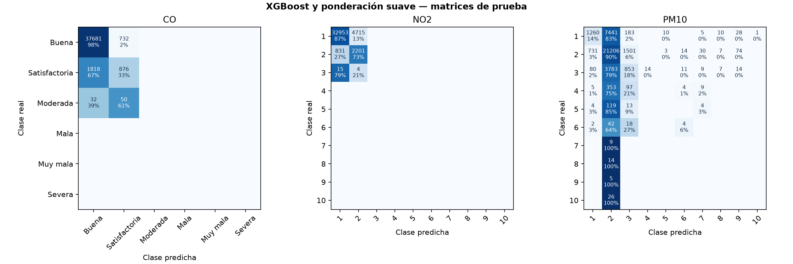
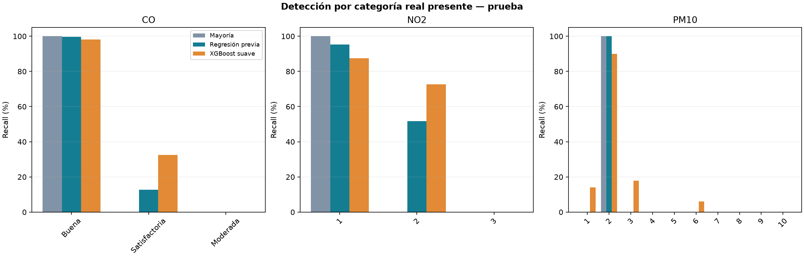

# XGBoost con ponderación suave: CO, NO₂ y PM10

Resultados horarios por estación.

- CO: accuracy 93.61%; F1 macro sobre clases presentes 0.4565 frente a 0.3939 de la regresión previa; balanced accuracy 43.54%.

- NO2: accuracy 86.33%; F1 macro sobre clases presentes 0.4548 frente a 0.4816 de la regresión previa; balanced accuracy 53.36%.

- PM10: accuracy 61.37%; F1 macro sobre clases presentes 0.1289 frente a 0.0766 de la regresión previa; balanced accuracy 12.80%.

## Método y alcance

- Tres clasificadores multiclase, uno por contaminante y compartidos entre estaciones. NO2/PM10 usan niveles británicos; CO usa categorías de India. No se combinan en un índice general.

- XGBoost usa la configuración elegida por validación en el piloto NO2 y exponente de pesos 0.5 fijo para los tres contaminantes. No se afirma que sea la configuración óptima para CO o PM10. Los pesos de cada contaminante se calculan sólo con sus ejemplos de entrenamiento.

- Se mantienen las 59 entradas, los cortes temporales y los descartes del modelado original. Entrenamiento anterior a 2024, validación en 2024 y prueba desde 2025; purga de dos días. Se excluyen objetivos interpolados y no se imputan faltantes del objetivo.

- NO2 reutiliza el modelo del piloto cuando se comprueba compatibilidad de datos, entradas, escala y parámetros; si no está disponible se entrena la misma configuración. Los modelos nuevos de CO y PM10 no se seleccionan ni ajustan usando test.

- Accuracy no demuestra detección de clases raras. Macro considera todas las categorías oficiales de la escala y usa cero cuando una métrica no puede calcularse; macro_supported sólo considera categorías reales presentes. Se informan ambas y el soporte por categoría.

- FPR se calcula por categoría contra el resto, FP/(FP+TN), y se promedia para el resumen macro. No equivale a la proporción de predicciones de esa categoría que fueron equivocadas; revisar también precision, recall y las matrices.

- En CO hay sólo tres de seis categorías en prueba. En NO2 sólo aparecen niveles 1–3, todos de contaminación baja. PM10 tiene los diez niveles en test, pero los elevados poseen pocos casos. Una clase sin ejemplos no puede darse por detectada ni evaluada.

- Las conversiones y promedios publicados se mantienen. La conversión de CO y su redondeo conservan las convenciones declaradas en el experimento de índices; no se certifica equivalencia instrumental ni cumplimiento normativo local.

- Se usan entradas ERA5 históricas y probabilidades sin calibración. Estos resultados no miden todavía el error operativo con meteorología pronosticada a 24/48 horas. El test ya había sido inspeccionado: la comparación es exploratoria y requiere confirmación independiente.

- Los tres modelos entrenados se exportan en formato nativo UBJ de XGBoost con metadatos JSON de entradas, codificación y escala. Las clases ausentes de entrenamiento conservan probabilidad cero. Los códigos exportados comienzan en cero: en DAQI el código 0 representa el nivel 1.

## Resumen solicitado: XGBoost suave, prueba

| pollutant | scheme | resolution | model | split | station | n | accuracy | precision_macro | recall_macro | f1_macro | precision_macro_supported | recall_macro_supported | f1_macro_supported | balanced_accuracy | f1_weighted | false_positive_rate_macro | ordinal_mae | classes_present | classes_declared | predicted_classes_present | classes_trained |
| --- | --- | --- | --- | --- | --- | --- | --- | --- | --- | --- | --- | --- | --- | --- | --- | --- | --- | --- | --- | --- | --- |
| CO | India_CO | level | XGBoost_suave | test | todas | 41189 | 0.9361 | 0.2469 | 0.2177 | 0.2282 | 0.4938 | 0.4354 | 0.4565 | 0.4354 | 0.9280 | 0.1145 | 0.0647 | 3 | 6 | 2 | 3 |
| NO2 | UK_DAQI | level | XGBoost_suave | test | todas | 40719 | 0.8633 | 0.1293 | 0.1601 | 0.1365 | 0.4310 | 0.5336 | 0.4548 | 0.5336 | 0.8860 | 0.0403 | 0.1370 | 3 | 10 | 2 | 8 |
| PM10 | UK_DAQI | level | XGBoost_suave | test | todas | 38003 | 0.6137 | 0.1689 | 0.1280 | 0.1289 | 0.1689 | 0.1280 | 0.1289 | 0.1280 | 0.5477 | 0.0906 | 0.4525 | 10 | 10 | 10 | 10 |

## Comparación con referencias en prueba

| pollutant | model | n | accuracy | precision_macro | recall_macro | f1_macro | f1_macro_supported | balanced_accuracy | f1_weighted | false_positive_rate_macro | ordinal_mae |
| --- | --- | --- | --- | --- | --- | --- | --- | --- | --- | --- | --- |
| CO | XGBoost_suave | 41189 | 0.9361 | 0.2469 | 0.2177 | 0.2282 | 0.4565 | 0.4354 | 0.9280 | 0.1145 | 0.0647 |
| CO | Regresion_previa | 41189 | 0.9377 | 0.2672 | 0.1873 | 0.1969 | 0.3939 | 0.3746 | 0.9168 | 0.1443 | 0.0633 |
| CO | Mayoria_train | 41189 | 0.9326 | 0.1554 | 0.1667 | 0.1609 | 0.3217 | 0.3333 | 0.9001 | 0.1667 | 0.0694 |
| NO2 | XGBoost_suave | 40719 | 0.8633 | 0.1293 | 0.1601 | 0.1365 | 0.4548 | 0.5336 | 0.8860 | 0.0403 | 0.1370 |
| NO2 | Regresion_previa | 40719 | 0.9192 | 0.1424 | 0.1469 | 0.1445 | 0.4816 | 0.4895 | 0.9209 | 0.0533 | 0.0812 |
| NO2 | Mayoria_train | 40719 | 0.9251 | 0.0925 | 0.1000 | 0.0961 | 0.3204 | 0.3333 | 0.8891 | 0.1000 | 0.0754 |
| PM10 | XGBoost_suave | 38003 | 0.6137 | 0.1689 | 0.1280 | 0.1289 | 0.1289 | 0.1280 | 0.5477 | 0.0906 | 0.4525 |
| PM10 | Regresion_previa | 38003 | 0.6201 | 0.0620 | 0.1000 | 0.0766 | 0.0766 | 0.1000 | 0.4747 | 0.1000 | 0.4132 |
| PM10 | Mayoria_train | 38003 | 0.6201 | 0.0620 | 0.1000 | 0.0766 | 0.0766 | 0.1000 | 0.4747 | 0.1000 | 0.4132 |

## Validación: configuración fija sin nueva selección

| pollutant | model | n | accuracy | precision_macro | recall_macro | f1_macro | f1_macro_supported | balanced_accuracy | f1_weighted | false_positive_rate_macro | ordinal_mae |
| --- | --- | --- | --- | --- | --- | --- | --- | --- | --- | --- | --- |
| CO | XGBoost_suave | 20137 | 0.9213 | 0.2284 | 0.1968 | 0.2055 | 0.4110 | 0.3937 | 0.9067 | 0.1371 | 0.0815 |
| CO | Regresion_previa | 20137 | 0.9274 | 0.2502 | 0.1806 | 0.1859 | 0.3718 | 0.3612 | 0.9015 | 0.1524 | 0.0752 |
| CO | Mayoria_train | 20137 | 0.9255 | 0.1542 | 0.1667 | 0.1602 | 0.3204 | 0.3333 | 0.8896 | 0.1667 | 0.0777 |
| NO2 | XGBoost_suave | 16976 | 0.8759 | 0.1569 | 0.1668 | 0.1610 | 0.5368 | 0.5559 | 0.8802 | 0.0332 | 0.1242 |
| NO2 | Regresion_previa | 16976 | 0.8864 | 0.1716 | 0.1440 | 0.1525 | 0.5082 | 0.4799 | 0.8723 | 0.0559 | 0.1137 |
| NO2 | Mayoria_train | 16976 | 0.8212 | 0.0821 | 0.1000 | 0.0902 | 0.3006 | 0.3333 | 0.7406 | 0.1000 | 0.1800 |
| PM10 | XGBoost_suave | 22522 | 0.6164 | 0.1512 | 0.1166 | 0.1118 | 0.1243 | 0.1295 | 0.5372 | 0.0926 | 0.4613 |
| PM10 | Regresion_previa | 22522 | 0.6246 | 0.0625 | 0.1000 | 0.0769 | 0.0854 | 0.1111 | 0.4803 | 0.1000 | 0.4322 |
| PM10 | Mayoria_train | 22522 | 0.6246 | 0.0625 | 0.1000 | 0.0769 | 0.0854 | 0.1111 | 0.4803 | 0.1000 | 0.4322 |

## Resultados por categoría de XGBoost suave — prueba

| pollutant | category | support | predicted_count | precision | recall | f1 | false_positive_rate | tp | fp | fn | tn |
| --- | --- | --- | --- | --- | --- | --- | --- | --- | --- | --- | --- |
| CO | Buena | 38413 | 39531 | 0.9532 | 0.9809 | 0.9669 | 0.6664 | 37681 | 1850 | 732 | 926 |
| CO | Satisfactoria | 2694 | 1658 | 0.5283 | 0.3252 | 0.4026 | 0.0203 | 876 | 782 | 1818 | 37713 |
| CO | Moderada | 82 | 0 | no evaluable | 0.0000 | 0.0000 | 0.0000 | 0 | 0 | 82 | 41107 |
| CO | Mala | 0 | 0 | no evaluable | no evaluable | no evaluable | 0.0000 | 0 | 0 | 0 | 41189 |
| CO | Muy mala | 0 | 0 | no evaluable | no evaluable | no evaluable | 0.0000 | 0 | 0 | 0 | 41189 |
| CO | Severa | 0 | 0 | no evaluable | no evaluable | no evaluable | 0.0000 | 0 | 0 | 0 | 41189 |
| NO2 | 1 · Baja | 37668 | 33799 | 0.9750 | 0.8748 | 0.9222 | 0.2773 | 32953 | 846 | 4715 | 2205 |
| NO2 | 2 · Baja | 3032 | 6920 | 0.3181 | 0.7259 | 0.4423 | 0.1252 | 2201 | 4719 | 831 | 32968 |
| NO2 | 3 · Baja | 19 | 0 | no evaluable | 0.0000 | 0.0000 | 0.0000 | 0 | 0 | 19 | 40700 |
| NO2 | 4 · Moderada | 0 | 0 | no evaluable | no evaluable | no evaluable | 0.0000 | 0 | 0 | 0 | 40719 |
| NO2 | 5 · Moderada | 0 | 0 | no evaluable | no evaluable | no evaluable | 0.0000 | 0 | 0 | 0 | 40719 |
| NO2 | 6 · Moderada | 0 | 0 | no evaluable | no evaluable | no evaluable | 0.0000 | 0 | 0 | 0 | 40719 |
| NO2 | 7 · Alta | 0 | 0 | no evaluable | no evaluable | no evaluable | 0.0000 | 0 | 0 | 0 | 40719 |
| NO2 | 8 · Alta | 0 | 0 | no evaluable | no evaluable | no evaluable | 0.0000 | 0 | 0 | 0 | 40719 |
| NO2 | 9 · Alta | 0 | 0 | no evaluable | no evaluable | no evaluable | 0.0000 | 0 | 0 | 0 | 40719 |
| NO2 | 10 · Muy alta | 0 | 0 | no evaluable | no evaluable | no evaluable | 0.0000 | 0 | 0 | 0 | 40719 |
| PM10 | 1 · Baja | 8938 | 2082 | 0.6052 | 0.1410 | 0.2287 | 0.0283 | 1260 | 822 | 7678 | 28243 |
| PM10 | 2 · Baja | 23566 | 32998 | 0.6426 | 0.8999 | 0.7498 | 0.8168 | 21206 | 11792 | 2360 | 2645 |
| PM10 | 3 · Baja | 4771 | 2665 | 0.3201 | 0.1788 | 0.2294 | 0.0545 | 853 | 1812 | 3918 | 31420 |
| PM10 | 4 · Moderada | 468 | 14 | 0.0000 | 0.0000 | 0.0000 | 0.0004 | 0 | 14 | 468 | 37521 |
| PM10 | 5 · Moderada | 140 | 13 | 0.0000 | 0.0000 | 0.0000 | 0.0003 | 0 | 13 | 140 | 37850 |
| PM10 | 6 · Moderada | 66 | 33 | 0.1212 | 0.0606 | 0.0808 | 0.0008 | 4 | 29 | 62 | 37908 |
| PM10 | 7 · Alta | 9 | 57 | 0.0000 | 0.0000 | 0.0000 | 0.0015 | 0 | 57 | 9 | 37937 |
| PM10 | 8 · Alta | 14 | 24 | 0.0000 | 0.0000 | 0.0000 | 0.0006 | 0 | 24 | 14 | 37965 |
| PM10 | 9 · Alta | 5 | 116 | 0.0000 | 0.0000 | 0.0000 | 0.0031 | 0 | 116 | 5 | 37882 |
| PM10 | 10 · Muy alta | 26 | 1 | 0.0000 | 0.0000 | 0.0000 | 0.0000 | 0 | 1 | 26 | 37976 |

## XGBoost suave por estación — prueba

| station | pollutant | model | n | accuracy | precision_macro | recall_macro | f1_macro | f1_macro_supported | balanced_accuracy | f1_weighted | false_positive_rate_macro | ordinal_mae |
| --- | --- | --- | --- | --- | --- | --- | --- | --- | --- | --- | --- | --- |
| centenario | CO | XGBoost_suave | 13845 | 0.9401 | 0.2187 | 0.2248 | 0.2216 | 0.4432 | 0.4497 | 0.9413 | 0.1068 | 0.0599 |
| cordoba | CO | XGBoost_suave | 13818 | 0.8761 | 0.2588 | 0.2160 | 0.2273 | 0.4547 | 0.4321 | 0.8554 | 0.1163 | 0.1256 |
| la_boca | CO | XGBoost_suave | 13526 | 0.9933 | 0.1656 | 0.1667 | 0.1661 | 0.3322 | 0.3333 | 0.9900 | 0.1667 | 0.0072 |
| centenario | NO2 | XGBoost_suave | 13874 | 0.9897 | 0.1010 | 0.1008 | 0.1009 | 0.5043 | 0.5038 | 0.9889 | 0.0992 | 0.0103 |
| cordoba | NO2 | XGBoost_suave | 13325 | 0.8875 | 0.1138 | 0.1348 | 0.1178 | 0.3926 | 0.4494 | 0.9107 | 0.0662 | 0.1134 |
| la_boca | NO2 | XGBoost_suave | 13520 | 0.7098 | 0.1306 | 0.1501 | 0.1297 | 0.4322 | 0.5002 | 0.7425 | 0.0500 | 0.2904 |
| centenario | PM10 | XGBoost_suave | 13329 | 0.5905 | 0.1539 | 0.1206 | 0.1168 | 0.1168 | 0.1206 | 0.5202 | 0.0893 | 0.4328 |
| cordoba | PM10 | XGBoost_suave | 12612 | 0.7016 | 0.1516 | 0.1188 | 0.1204 | 0.1204 | 0.1188 | 0.6381 | 0.0925 | 0.3356 |
| la_boca | PM10 | XGBoost_suave | 12062 | 0.5474 | 0.1760 | 0.1266 | 0.1233 | 0.1233 | 0.1266 | 0.4833 | 0.0922 | 0.5964 |

## Fuentes

- [uk_thresholds](https://www.gov.uk/government/publications/health-effects-of-air-pollution/pollutant-concentrations-for-the-daily-air-quality-index-daqi)

- [uk_rounding](https://uk-air.defra.gov.uk/reports/cat14/1304251155_Update_on_Implementation_of_the_DAQI_April_2013_Final.pdf)

- [gas_conversion](https://uk-air.defra.gov.uk/reports/cat06/0502160851_Conversion_Factors_Between_ppb_and.pdf)

- [india_thresholds](https://www.cpcb.gov.in/displaypdf.php?id=bmF0aW9uYWwtYWlyLXF1YWxpdHktaW5kZXgvRklOQUwtUkVQT1JUX0FRSV8ucGRm)
