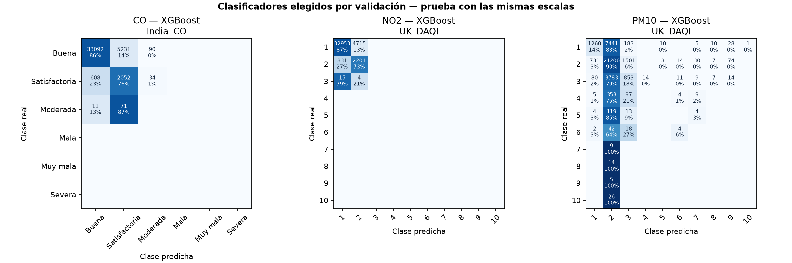
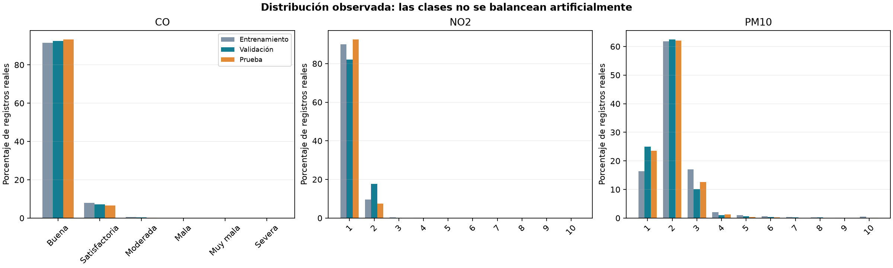

# Comparación ampliada de clasificadores

Incluye el resumen de los tres XGBoost suaves y las pruebas adicionales.

- CO: elegido XGBoost, ponderación 1; F1 clases presentes test 0.4420, frente a 0.4565 de XGBoost suave; accuracy 85.32%.

- NO2: elegido XGBoost, ponderación 0.5; F1 clases presentes test 0.4548, frente a 0.4548 de XGBoost suave; accuracy 86.33%.

- PM10: elegido XGBoost, ponderación 0.5; F1 clases presentes test 0.1289, frente a 0.1289 de XGBoost suave; accuracy 61.37%.

## Método y alcance

- Se comparan Random Forest y XGBoost con pesos 0, 0.5 y 1 para CO y PM10. NO2 reutiliza su piloto previo. La configuración de árboles permanece fija; se elige técnica y ponderación por F1 macro de validación.

- Los XGBoost suaves ya entrenados se reutilizan después de comprobar hashes, datos, escala y parámetros. Los pesos se calculan sólo en entrenamiento. No se fabrican ejemplos ni se reequilibra test.

- Las selecciones por contaminante se guardan antes de calcular test. No se cambia una elección porque otra alternativa tenga mejores números de prueba. Las referencias previas y los XGBoost suaves se conservan.

- Macro considera todas las clases declaradas, con cero en métricas no evaluables. Macro_supported considera sólo categorías reales presentes. El FPR por clase es FP/(FP+TN), no uno menos precision.

- Los contaminantes usan escalas distintas: India para CO y DAQI británico para NO2/PM10. No hay un índice general de estación o CABA. En NO2 los tres niveles de test pertenecen a contaminación baja. En CO faltan las categorías superiores y en PM10 los casos elevados son escasos.

- Se conservan las mismas entradas, filas válidas, ventanas publicadas, conversiones y cortes temporales. ERA5 es meteorología histórica: esta experiencia no mide el error operativo del pronóstico a 24/48 h.

- Test ya había sido inspeccionado y motivó ampliar las pruebas: se trata de una comparación exploratoria. Una confirmación independiente requiere datos posteriores o un nuevo protocolo temporal.

## Resumen solicitado: XGBoost suave — test

| Contaminante | Accuracy | Precision macro | Recall macro | F1 macro | FPR macro |
| --- | --- | --- | --- | --- | --- |
| CO | 0.9361 | 0.2469 | 0.2177 | 0.2282 | 0.1145 |
| NO2 | 0.8633 | 0.1293 | 0.1601 | 0.1365 | 0.0403 |
| PM10 | 0.6137 | 0.1689 | 0.1280 | 0.1289 | 0.0906 |

## XGBoost suave: clases presentes y métricas adicionales

| pollutant | classes_present | classes_declared | precision_macro_supported | recall_macro_supported | f1_macro_supported | balanced_accuracy | f1_weighted | ordinal_mae |
| --- | --- | --- | --- | --- | --- | --- | --- | --- |
| CO | 3 | 6 | 0.4938 | 0.4354 | 0.4565 | 0.4354 | 0.9280 | 0.0647 |
| NO2 | 3 | 10 | 0.4310 | 0.5336 | 0.4548 | 0.5336 | 0.8860 | 0.1370 |
| PM10 | 10 | 10 | 0.1689 | 0.1280 | 0.1289 | 0.1280 | 0.5477 | 0.4525 |

## Clasificadores elegidos por validación — test

| weight_power | pollutant | model | n | accuracy | precision_macro | recall_macro | f1_macro | f1_macro_supported | balanced_accuracy | false_positive_rate_macro | f1_weighted | ordinal_mae |
| --- | --- | --- | --- | --- | --- | --- | --- | --- | --- | --- | --- | --- |
| 1.0000 | CO | XGBoost | 41189 | 0.8532 | 0.2101 | 0.2705 | 0.2210 | 0.4420 | 0.5411 | 0.0606 | 0.8825 | 0.1492 |
| 0.5000 | PM10 | XGBoost | 38003 | 0.6137 | 0.1689 | 0.1280 | 0.1289 | 0.1289 | 0.1280 | 0.0906 | 0.5477 | 0.4525 |
| 0.5000 | NO2 | XGBoost | 40719 | 0.8633 | 0.1293 | 0.1601 | 0.1365 | 0.4548 | 0.5336 | 0.0403 | 0.8860 | 0.1370 |

## Comparación de todos los enfoques finalistas — test

| pollutant | model | n | accuracy | precision_macro | recall_macro | f1_macro | f1_macro_supported | balanced_accuracy | false_positive_rate_macro | f1_weighted | ordinal_mae |
| --- | --- | --- | --- | --- | --- | --- | --- | --- | --- | --- | --- |
| CO | XGBoost_suave | 41189 | 0.9361 | 0.2469 | 0.2177 | 0.2282 | 0.4565 | 0.4354 | 0.1145 | 0.9280 | 0.0647 |
| CO | Regresion_previa | 41189 | 0.9377 | 0.2672 | 0.1873 | 0.1969 | 0.3939 | 0.3746 | 0.1443 | 0.9168 | 0.0633 |
| CO | Mayoria_train | 41189 | 0.9326 | 0.1554 | 0.1667 | 0.1609 | 0.3217 | 0.3333 | 0.1667 | 0.9001 | 0.0694 |
| CO | RandomForest | 41189 | 0.8520 | 0.2164 | 0.2680 | 0.2235 | 0.4469 | 0.5361 | 0.0684 | 0.8806 | 0.1489 |
| CO | XGBoost | 41189 | 0.8532 | 0.2101 | 0.2705 | 0.2210 | 0.4420 | 0.5411 | 0.0606 | 0.8825 | 0.1492 |
| PM10 | XGBoost_suave | 38003 | 0.6137 | 0.1689 | 0.1280 | 0.1289 | 0.1289 | 0.1280 | 0.0906 | 0.5477 | 0.4525 |
| PM10 | Regresion_previa | 38003 | 0.6201 | 0.0620 | 0.1000 | 0.0766 | 0.0766 | 0.1000 | 0.1000 | 0.4747 | 0.4132 |
| PM10 | Mayoria_train | 38003 | 0.6201 | 0.0620 | 0.1000 | 0.0766 | 0.0766 | 0.1000 | 0.1000 | 0.4747 | 0.4132 |
| PM10 | RandomForest | 38003 | 0.3771 | 0.1258 | 0.1227 | 0.1097 | 0.1097 | 0.1227 | 0.0917 | 0.4312 | 1.3916 |
| PM10 | XGBoost | 38003 | 0.6137 | 0.1689 | 0.1280 | 0.1289 | 0.1289 | 0.1280 | 0.0906 | 0.5477 | 0.4525 |
| NO2 | Regresion_previa | 40719 | 0.9192 | 0.1424 | 0.1469 | 0.1445 | 0.4816 | 0.4895 | 0.0533 | 0.9209 | 0.0812 |
| NO2 | Mayoria_train | 40719 | 0.9251 | 0.0925 | 0.1000 | 0.0961 | 0.3204 | 0.3333 | 0.1000 | 0.8891 | 0.0754 |
| NO2 | RandomForest | 40719 | 0.8604 | 0.1251 | 0.1472 | 0.1308 | 0.4360 | 0.4907 | 0.0530 | 0.8811 | 0.1400 |
| NO2 | XGBoost | 40719 | 0.8633 | 0.1293 | 0.1601 | 0.1365 | 0.4548 | 0.5336 | 0.0403 | 0.8860 | 0.1370 |
| NO2 | XGBoost_suave | 40719 | 0.8633 | 0.1293 | 0.1601 | 0.1365 | 0.4548 | 0.5336 | 0.0403 | 0.8860 | 0.1370 |

## Las 18 variantes y sus métricas de validación

| pollutant | model | weight_power | validation_accuracy | validation_precision_macro | validation_recall_macro | validation_f1_macro | validation_f1_macro_supported | validation_balanced_accuracy | validation_false_positive_rate_macro |
| --- | --- | --- | --- | --- | --- | --- | --- | --- | --- |
| CO | RandomForest | 0.0000 | 0.9244 | 0.1988 | 0.1678 | 0.1628 | 0.3256 | 0.3355 | 0.1656 |
| CO | RandomForest | 0.5000 | 0.9136 | 0.2119 | 0.1915 | 0.1975 | 0.3949 | 0.3830 | 0.1414 |
| CO | RandomForest | 1.0000 | 0.8506 | 0.2011 | 0.2334 | 0.2089 | 0.4178 | 0.4668 | 0.0995 |
| CO | XGBoost | 0.0000 | 0.9250 | 0.1876 | 0.1669 | 0.1609 | 0.3217 | 0.3338 | 0.1664 |
| CO | XGBoost | 0.5000 | 0.9213 | 0.2284 | 0.1968 | 0.2055 | 0.4110 | 0.3937 | 0.1371 |
| CO | XGBoost | 1.0000 | 0.8499 | 0.2087 | 0.2443 | 0.2158 | 0.4316 | 0.4885 | 0.0912 |
| PM10 | RandomForest | 0.0000 | 0.6121 | 0.1490 | 0.1060 | 0.0924 | 0.1026 | 0.1177 | 0.0978 |
| PM10 | RandomForest | 0.5000 | 0.5628 | 0.1229 | 0.1024 | 0.0955 | 0.1061 | 0.1138 | 0.0973 |
| PM10 | RandomForest | 1.0000 | 0.3981 | 0.1263 | 0.1075 | 0.1088 | 0.1208 | 0.1194 | 0.0913 |
| PM10 | XGBoost | 0.0000 | 0.6265 | 0.1905 | 0.1020 | 0.0816 | 0.0907 | 0.1134 | 0.0991 |
| PM10 | XGBoost | 0.5000 | 0.6164 | 0.1512 | 0.1166 | 0.1118 | 0.1243 | 0.1295 | 0.0926 |
| PM10 | XGBoost | 1.0000 | 0.3426 | 0.1299 | 0.1117 | 0.1059 | 0.1177 | 0.1241 | 0.0896 |
| NO2 | RandomForest | 0.0000 | 0.8769 | 0.1621 | 0.1459 | 0.1518 | 0.5062 | 0.4863 | 0.0540 |
| NO2 | RandomForest | 0.5000 | 0.8709 | 0.1556 | 0.1589 | 0.1572 | 0.5239 | 0.5298 | 0.0410 |
| NO2 | RandomForest | 1.0000 | 0.7628 | 0.1378 | 0.1600 | 0.1400 | 0.4666 | 0.5333 | 0.0400 |
| NO2 | XGBoost | 0.0000 | 0.8620 | 0.1693 | 0.1271 | 0.1344 | 0.4479 | 0.4237 | 0.0726 |
| NO2 | XGBoost | 0.5000 | 0.8759 | 0.1569 | 0.1668 | 0.1610 | 0.5368 | 0.5559 | 0.0332 |
| NO2 | XGBoost | 1.0000 | 0.6615 | 0.1325 | 0.1558 | 0.1246 | 0.4154 | 0.5192 | 0.0443 |

## Detalle por categoría del clasificador elegido — test

| pollutant | model | category | support | precision | recall | f1 | false_positive_rate | tp | fp | fn | tn |
| --- | --- | --- | --- | --- | --- | --- | --- | --- | --- | --- | --- |
| CO | XGBoost | Buena | 38413 | 0.9816 | 0.8615 | 0.9176 | 0.2230 | 33092 | 619 | 5321 | 2157 |
| CO | XGBoost | Satisfactoria | 2694 | 0.2790 | 0.7617 | 0.4084 | 0.1377 | 2052 | 5302 | 642 | 33193 |
| CO | XGBoost | Moderada | 82 | 0.0000 | 0.0000 | 0.0000 | 0.0030 | 0 | 124 | 82 | 40983 |
| CO | XGBoost | Mala | 0 | no evaluable | no evaluable | no evaluable | 0.0000 | 0 | 0 | 0 | 41189 |
| CO | XGBoost | Muy mala | 0 | no evaluable | no evaluable | no evaluable | 0.0000 | 0 | 0 | 0 | 41189 |
| CO | XGBoost | Severa | 0 | no evaluable | no evaluable | no evaluable | 0.0000 | 0 | 0 | 0 | 41189 |
| PM10 | XGBoost | 1 · Baja | 8938 | 0.6052 | 0.1410 | 0.2287 | 0.0283 | 1260 | 822 | 7678 | 28243 |
| PM10 | XGBoost | 2 · Baja | 23566 | 0.6426 | 0.8999 | 0.7498 | 0.8168 | 21206 | 11792 | 2360 | 2645 |
| PM10 | XGBoost | 3 · Baja | 4771 | 0.3201 | 0.1788 | 0.2294 | 0.0545 | 853 | 1812 | 3918 | 31420 |
| PM10 | XGBoost | 4 · Moderada | 468 | 0.0000 | 0.0000 | 0.0000 | 0.0004 | 0 | 14 | 468 | 37521 |
| PM10 | XGBoost | 5 · Moderada | 140 | 0.0000 | 0.0000 | 0.0000 | 0.0003 | 0 | 13 | 140 | 37850 |
| PM10 | XGBoost | 6 · Moderada | 66 | 0.1212 | 0.0606 | 0.0808 | 0.0008 | 4 | 29 | 62 | 37908 |
| PM10 | XGBoost | 7 · Alta | 9 | 0.0000 | 0.0000 | 0.0000 | 0.0015 | 0 | 57 | 9 | 37937 |
| PM10 | XGBoost | 8 · Alta | 14 | 0.0000 | 0.0000 | 0.0000 | 0.0006 | 0 | 24 | 14 | 37965 |
| PM10 | XGBoost | 9 · Alta | 5 | 0.0000 | 0.0000 | 0.0000 | 0.0031 | 0 | 116 | 5 | 37882 |
| PM10 | XGBoost | 10 · Muy alta | 26 | 0.0000 | 0.0000 | 0.0000 | 0.0000 | 0 | 1 | 26 | 37976 |
| NO2 | XGBoost | 1 · Baja | 37668 | 0.9750 | 0.8748 | 0.9222 | 0.2773 | 32953 | 846 | 4715 | 2205 |
| NO2 | XGBoost | 2 · Baja | 3032 | 0.3181 | 0.7259 | 0.4423 | 0.1252 | 2201 | 4719 | 831 | 32968 |
| NO2 | XGBoost | 3 · Baja | 19 | no evaluable | 0.0000 | 0.0000 | 0.0000 | 0 | 0 | 19 | 40700 |
| NO2 | XGBoost | 4 · Moderada | 0 | no evaluable | no evaluable | no evaluable | 0.0000 | 0 | 0 | 0 | 40719 |
| NO2 | XGBoost | 5 · Moderada | 0 | no evaluable | no evaluable | no evaluable | 0.0000 | 0 | 0 | 0 | 40719 |
| NO2 | XGBoost | 6 · Moderada | 0 | no evaluable | no evaluable | no evaluable | 0.0000 | 0 | 0 | 0 | 40719 |
| NO2 | XGBoost | 7 · Alta | 0 | no evaluable | no evaluable | no evaluable | 0.0000 | 0 | 0 | 0 | 40719 |
| NO2 | XGBoost | 8 · Alta | 0 | no evaluable | no evaluable | no evaluable | 0.0000 | 0 | 0 | 0 | 40719 |
| NO2 | XGBoost | 9 · Alta | 0 | no evaluable | no evaluable | no evaluable | 0.0000 | 0 | 0 | 0 | 40719 |
| NO2 | XGBoost | 10 · Muy alta | 0 | no evaluable | no evaluable | no evaluable | 0.0000 | 0 | 0 | 0 | 40719 |

## Fuentes

- [uk_thresholds](https://www.gov.uk/government/publications/health-effects-of-air-pollution/pollutant-concentrations-for-the-daily-air-quality-index-daqi)

- [uk_rounding](https://uk-air.defra.gov.uk/reports/cat14/1304251155_Update_on_Implementation_of_the_DAQI_April_2013_Final.pdf)

- [gas_conversion](https://uk-air.defra.gov.uk/reports/cat06/0502160851_Conversion_Factors_Between_ppb_and.pdf)

- [india_thresholds](https://www.cpcb.gov.in/displaypdf.php?id=bmF0aW9uYWwtYWlyLXF1YWxpdHktaW5kZXgvRklOQUwtUkVQT1JUX0FRSV8ucGRm)
