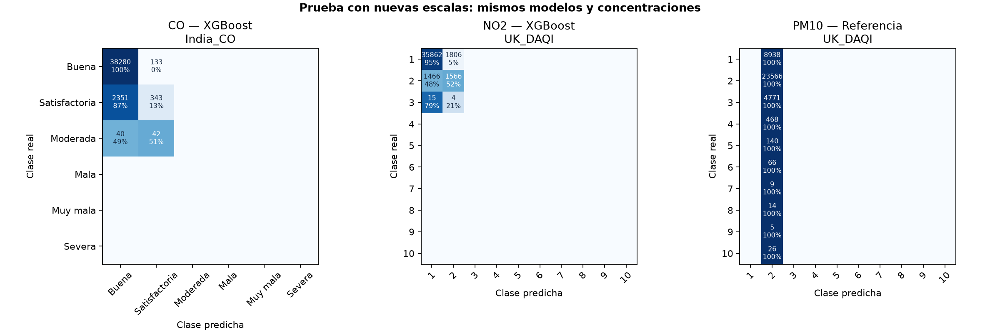

# Comparación UK/India por contaminante

Experimento de reetiquetado sobre predicciones existentes.

- CO: accuracy 93.77%, F1 macro de clases presentes 0.3939, balanced accuracy 37.46%. Mayoría de entrenamiento: accuracy 93.26% y F1 de clases presentes 0.3217.

- NO2: accuracy 91.92%, F1 macro de clases presentes 0.4816, balanced accuracy 48.95%. Mayoría de entrenamiento: accuracy 92.51% y F1 de clases presentes 0.3204.

- PM10: accuracy 62.01%, F1 macro de clases presentes 0.0766, balanced accuracy 10.00%. Mayoría de entrenamiento: accuracy 62.01% y F1 de clases presentes 0.0766.

## Alcance y método

- Se reetiquetan las concentraciones reales y predichas guardadas; no se entrena de nuevo. MAE, RMSE y R² no cambian. Los modelos continúan seleccionados con la validación original de regresión.

- Esta prueba compara objetivos diferentes: cambiar etiquetas no demuestra que haya mejorado el mismo modelo ni permite comparar directamente los F1 de escalas con distinto número de clases. Los resultados de test ya inspeccionados no serán una evaluación ciega de futuras decisiones de selección.

- Se conservan las particiones temporales, los filtros de plausibilidad y la exclusión de objetivos interpolados. La nueva referencia de categoría mayoritaria se calcula sólo con entrenamiento.

- NO2: DAQI de 1 hora, ppb × 1.9125. PM10: límites DAQI aplicados al móvil de 24 horas publicado, sin promediarlo otra vez. No se certifica equivalencia instrumental europea ni se llama AQI diario oficial al máximo de valores móviles durante la jornada.

- CO: límites CPCB de 8 horas, ppm × 1.15, adoptando como convención 25 °C y 1013 mb. No se verificó esa condición de referencia en los sensores CABA. El redondeo de CO a una decimal es una convención explícita de esta comparación, no una instrucción atribuida a CPCB.

- Se informa por separado cada contaminante. No se combinan niveles DAQI con categorías India ni se modifica el clasificador diario EPA. No existe una nueva etiqueta general de estación/CABA en este experimento.

- Macro usa todas las clases declaradas y cero en las no evaluables. Macro_supported usa sólo clases reales presentes. Se informa cobertura y detalle por clase; FPR es FP/(FP+TN) de cada clase contra el resto. FPR de categorías no predichas puede ser cero aunque recall también sea cero.

- Los límites se verificaron en fuentes oficiales el 18/10/2026. Las conversiones son convenciones a condiciones de referencia fijas, no ajustes con meteorología futura.

## Resultados por nivel o categoría nativa — test

| pollutant | model | classes_present | classes_declared | accuracy | precision_macro | recall_macro | f1_macro | f1_macro_supported | balanced_accuracy | false_positive_rate_macro |
| --- | --- | --- | --- | --- | --- | --- | --- | --- | --- | --- |
| CO | XGBoost | 3 | 6 | 0.9377 | 0.2672 | 0.1873 | 0.1969 | 0.3939 | 0.3746 | 0.1443 |
| NO2 | XGBoost | 3 | 10 | 0.9192 | 0.1424 | 0.1469 | 0.1445 | 0.4816 | 0.4895 | 0.0533 |
| PM10 | Referencia | 10 | 10 | 0.6201 | 0.0620 | 0.1000 | 0.0766 | 0.0766 | 0.1000 | 0.1000 |

## Referencia de clase mayoritaria del entrenamiento — test

| pollutant | accuracy | f1_macro | f1_macro_supported | balanced_accuracy |
| --- | --- | --- | --- | --- |
| CO | 0.9326 | 0.1609 | 0.3217 | 0.3333 |
| NO2 | 0.9251 | 0.0961 | 0.3204 | 0.3333 |
| PM10 | 0.6201 | 0.0766 | 0.0766 | 0.1000 |

## Detalle de clases reales presentes — test

| pollutant | category | support | predicted_count | precision | recall | f1 | false_positive_rate |
| --- | --- | --- | --- | --- | --- | --- | --- |
| CO | Buena | 38413 | 40671 | 0.9412 | 0.9965 | 0.9681 | 0.8613 |
| CO | Satisfactoria | 2694 | 518 | 0.6622 | 0.1273 | 0.2136 | 0.0045 |
| CO | Moderada | 82 | 0 | no evaluable | 0.0000 | 0.0000 | 0.0000 |
| NO2 | 1 · Baja | 37668 | 37343 | 0.9603 | 0.9521 | 0.9562 | 0.4854 |
| NO2 | 2 · Baja | 3032 | 3376 | 0.4639 | 0.5165 | 0.4888 | 0.0480 |
| NO2 | 3 · Baja | 19 | 0 | no evaluable | 0.0000 | 0.0000 | 0.0000 |
| PM10 | 1 · Baja | 8938 | 0 | no evaluable | 0.0000 | 0.0000 | 0.0000 |
| PM10 | 2 · Baja | 23566 | 38003 | 0.6201 | 1.0000 | 0.7655 | 1.0000 |
| PM10 | 3 · Baja | 4771 | 0 | no evaluable | 0.0000 | 0.0000 | 0.0000 |
| PM10 | 4 · Moderada | 468 | 0 | no evaluable | 0.0000 | 0.0000 | 0.0000 |
| PM10 | 5 · Moderada | 140 | 0 | no evaluable | 0.0000 | 0.0000 | 0.0000 |
| PM10 | 6 · Moderada | 66 | 0 | no evaluable | 0.0000 | 0.0000 | 0.0000 |
| PM10 | 7 · Alta | 9 | 0 | no evaluable | 0.0000 | 0.0000 | 0.0000 |
| PM10 | 8 · Alta | 14 | 0 | no evaluable | 0.0000 | 0.0000 | 0.0000 |
| PM10 | 9 · Alta | 5 | 0 | no evaluable | 0.0000 | 0.0000 | 0.0000 |
| PM10 | 10 · Muy alta | 26 | 0 | no evaluable | 0.0000 | 0.0000 | 0.0000 |

## Las cuatro bandas británicas — test

| pollutant | model | classes_present | classes_declared | accuracy | precision_macro | recall_macro | f1_macro | f1_macro_supported | balanced_accuracy | false_positive_rate_macro |
| --- | --- | --- | --- | --- | --- | --- | --- | --- | --- | --- |
| NO2 | XGBoost | 1 | 4 | 1.0000 | 0.2500 | 0.2500 | 0.2500 | 1.0000 | 1.0000 | 0.0000 |
| PM10 | Referencia | 4 | 4 | 0.9808 | 0.2452 | 0.2500 | 0.2476 | 0.2476 | 0.2500 | 0.2500 |

## Distribución real de niveles — test

| pollutant | category | count | fraction |
| --- | --- | --- | --- |
| CO | Buena | 38413 | 0.9326 |
| CO | Satisfactoria | 2694 | 0.0654 |
| CO | Moderada | 82 | 0.0020 |
| CO | Mala | 0 | 0.0000 |
| CO | Muy mala | 0 | 0.0000 |
| CO | Severa | 0 | 0.0000 |
| NO2 | 1 · Baja | 37668 | 0.9251 |
| NO2 | 2 · Baja | 3032 | 0.0745 |
| NO2 | 3 · Baja | 19 | 0.0005 |
| NO2 | 4 · Moderada | 0 | 0.0000 |
| NO2 | 5 · Moderada | 0 | 0.0000 |
| NO2 | 6 · Moderada | 0 | 0.0000 |
| NO2 | 7 · Alta | 0 | 0.0000 |
| NO2 | 8 · Alta | 0 | 0.0000 |
| NO2 | 9 · Alta | 0 | 0.0000 |
| NO2 | 10 · Muy alta | 0 | 0.0000 |
| PM10 | 1 · Baja | 8938 | 0.2352 |
| PM10 | 2 · Baja | 23566 | 0.6201 |
| PM10 | 3 · Baja | 4771 | 0.1255 |
| PM10 | 4 · Moderada | 468 | 0.0123 |
| PM10 | 5 · Moderada | 140 | 0.0037 |
| PM10 | 6 · Moderada | 66 | 0.0017 |
| PM10 | 7 · Alta | 9 | 0.0002 |
| PM10 | 8 · Alta | 14 | 0.0004 |
| PM10 | 9 · Alta | 5 | 0.0001 |
| PM10 | 10 · Muy alta | 26 | 0.0007 |

## Control EPA original con las mismas predicciones — test

| pollutant | model | classes_present | classes_declared | accuracy | precision_macro | recall_macro | f1_macro | f1_macro_supported | balanced_accuracy | false_positive_rate_macro |
| --- | --- | --- | --- | --- | --- | --- | --- | --- | --- | --- |
| CO | XGBoost | 1 | 3 | 1.0000 | 0.3333 | 0.3333 | 0.3333 | 1.0000 | 1.0000 | 0.0000 |
| NO2 | XGBoost | 2 | 3 | 0.9947 | 0.3316 | 0.3333 | 0.3324 | 0.4987 | 0.5000 | 0.3333 |
| PM10 | Referencia | 3 | 3 | 0.9894 | 0.3298 | 0.3333 | 0.3316 | 0.3316 | 0.3333 | 0.3333 |

## Figuras

## Fuentes

- [uk_thresholds](https://www.gov.uk/government/publications/health-effects-of-air-pollution/pollutant-concentrations-for-the-daily-air-quality-index-daqi)

- [uk_rounding](https://uk-air.defra.gov.uk/reports/cat14/1304251155_Update_on_Implementation_of_the_DAQI_April_2013_Final.pdf)

- [gas_conversion](https://uk-air.defra.gov.uk/reports/cat06/0502160851_Conversion_Factors_Between_ppb_and.pdf)

- [india_thresholds](https://www.cpcb.gov.in/displaypdf.php?id=bmF0aW9uYWwtYWlyLXF1YWxpdHktaW5kZXgvRklOQUwtUkVQT1JUX0FRSV8ucGRm)
